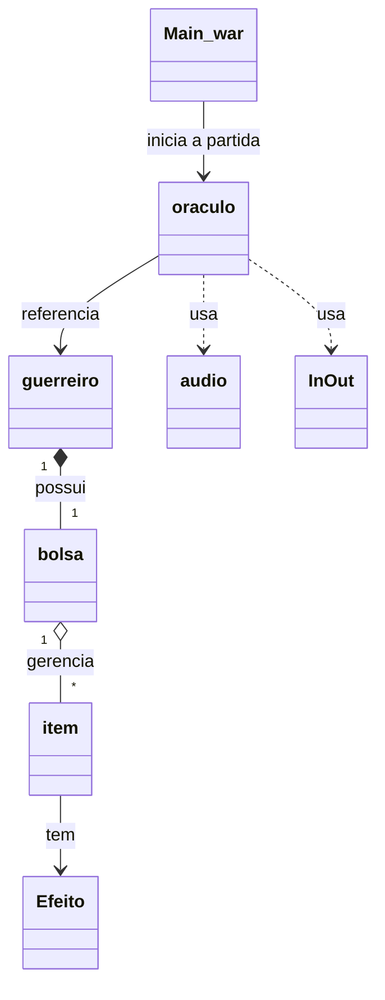

<div align="center">

# ⚡ Oráculo dos Doze

**Jogo de aventura em Java inspirado na mitologia grega**


[Visão geral](#-visão-geral) •
[Itens](#-itens-de-ajuda) •
[Arquitetura](#-arquitetura) •
[Como executar](#-como-executar) •
[Melhorias](#-melhorias-futuras)

</div>

---

## 📖 Visão geral

O jogador assume o papel de um guerreiro escolhido pelo Olimpo e precisa superar **três desafios** para vencer o Oráculo.

O projeto foi desenvolvido como prática de **Programação Orientada a Objetos (POO)**, explorando classes, objetos, relacionamentos, coleções, enums, métodos e controle de fluxo.

### Antes da partida

- O jogador informa os nomes dos participantes.
- O sistema sorteia de **9 a 12 vidas**.
- O jogador escolhe até **3 itens de ajuda** entre 6 opções.

### As três fases

| # | Fase | Desafio |
|:-:|------|---------|
| 1 | **A Rifa de Apolo** | Descobrir um número secreto entre 1 e 100. |
| 2 | **As Charadas de Atena** | Resolver três enigmas. Respostas incorretas consomem vidas. |
| 3 | **Desafio final: Pedra, Papel ou Tesoura** | Enfrentar o Oráculo em até três rodadas e vencer pelo menos duas. |

> [!TIP]
> Se as vidas acabarem, o jogador tem **uma única chance** de pedir misericórdia ao Oráculo. Uma frase com mais de cinco palavras pode garantir uma vida extra.

O jogo conta ainda com narrativa de introdução, mensagens de vitória e derrota, música de fundo e áudio de fim de jogo.

## ✨ Funcionalidades

- Três fases com desafios e regras distintas
- Sorteio inicial de vidas (9 a 12)
- Seleção e equipamento de até três itens de uma bolsa com seis opções
- Efeitos dos itens integrados aos desafios
- Controle de vidas, com bloqueio de uma perda pelo Escudo Égide de Zeus
- Uma oportunidade de solicitar uma vida extra ao Oráculo
- Mensagens de progresso, vitória, derrota e relatório final
- Reprodução de áudio com a API de som do Java
- Recursos de áudio e imagem armazenados no próprio projeto

## 🏺 Itens de ajuda

Cada item é consumido quando seu efeito é ativado.

| Item | Efeito |
|------|--------|
| 🗡️ Espada de Bronze de Ares | Na fase 3, transforma um empate em vitória. |
| 🔱 Lança de Atena | Fornece uma dica para a charada atual na fase 2. |
| 🏹 Arco de Ártemis | Mostra uma faixa de números que contém o número secreto na fase 1. |
| 🛡️ Escudo Égide de Zeus | Bloqueia automaticamente uma perda de vida. |
| ⛑️ Elmo de Hades | Permite pular uma charada sem perder vida. |
| 👟 Sandálias Aladas de Hermes | Concede duas tentativas extras na fase 1. |

> [!NOTE]
> Na fase das charadas, digite `AJUDA` para usar a Lança de Atena ou `PULAR` para usar o Elmo de Hades. Se não houver item disponível, o jogo informa que a ajuda não pode ser usada.

## 🏗️ Arquitetura

### Relacionamentos entre as classes



### Responsabilidades

| Classe | Responsabilidade |
|--------|------------------|
| `Main_war` | Inicializa a partida, organiza a sequência das fases e determina o encerramento. |
| `guerreiro` | Armazena os dados do personagem, administra as vidas e mantém sua bolsa de itens. |
| `oraculo` | Concentra a narrativa, os desafios, a ativação dos efeitos e o relatório final. |
| `bolsa` | Cria e gerencia os itens, permitindo equipar, desequipar e localizar ajudas utilizáveis. |
| `item` | Representa cada item: identificação, descrição, estado de equipamento, estado de uso e efeito. |
| `Efeito` | Enum que define os tipos de efeito dos itens. |
| `audio` | Centraliza a reprodução, a interrupção e o áudio de fim de jogo. |
| `InOut` | Classe auxiliar para entrada de dados e mensagens em janelas de diálogo. |

<details>
<summary><b>🧠 Conceitos e tecnologias aplicados</b></summary>

<br>

| Conceito | Aplicação no projeto |
|----------|----------------------|
| **Java** | Linguagem de desenvolvimento. |
| **POO** | Classes, objetos, construtores, atributos e métodos. |
| **Encapsulamento** | Atributos privados e métodos de acesso em `guerreiro` e `item`. |
| **Relacionamento entre objetos** | `guerreiro` possui uma `bolsa`; `oraculo` mantém uma referência ao guerreiro da partida. |
| **Enum** | `Efeito` representa os tipos de efeito dos itens. |
| **Collections Framework** | `List<item>` e `ArrayList` para administrar os itens. |
| **Controle de fluxo** | Laços, condicionais e métodos `boolean` para controlar o avanço pelas fases. |
| **Valores aleatórios** | `Math.random()` para sortear vidas, número secreto e jogadas do Oráculo. |
| **Java Sound API** | Reprodução de áudio com `AudioSystem` e `Clip`. |
| **Interface por diálogos** | Entrada e mensagens em janelas, via `InOut`. |

</details>

## ▶️ Como executar

### Requisitos

- **JDK** compatível (o projeto NetBeans está configurado para Java 25)
- **NetBeans IDE** ou outra IDE que abra projetos Java Ant
- Saída de áudio, para ouvir as músicas do jogo

### Pelo terminal

```bash
git clone https://github.com/SEU-USUARIO/oraculo-dos-doze.git
cd oraculo-dos-doze
ant run
```

> [!NOTE]
> O comando `ant run` exige o [Apache Ant](https://ant.apache.org/) instalado.

### Pelo NetBeans

1. Clone o repositório ou baixe o projeto.
2. Acesse **File → Open Project** e selecione a pasta com o `build.xml`.
3. Configure um JDK compatível.
4. Execute o projeto. A classe principal é `main_war.Main_war`.

> [!IMPORTANT]
> Mantenha a estrutura de recursos do projeto para que os arquivos de áudio e imagem sejam encontrados pelo código.

## 📁 Estrutura do projeto

```text
src/
├── main_war/
│   ├── Main_war.java
│   ├── guerreiro.java
│   ├── oraculo.java
│   ├── bolsa.java
│   ├── item.java
│   ├── Efeito.java
│   ├── audio.java
│   └── InOut.java
└── recursos/
    ├── oraculo.png
    ├── sanctuaryGuardians.wav
    └── badDream.wav
```

A localização exata dos recursos pode variar conforme a configuração da versão utilizada.

## 🚀 Melhorias futuras

- [ ] Criar testes para os efeitos dos itens e para as condições de vitória e derrota
- [ ] Revisar o tratamento de entradas inválidas e situações-limite
- [ ] Padronizar nomes (classes em `PascalCase`: `Guerreiro`, `Oraculo`, `Bolsa`, `Item`) e melhorar o encapsulamento
- [ ] Revisar o gerenciamento do áudio de fim de jogo

## 🎯 Objetivo do projeto

Projeto acadêmico de aprendizado que transforma regras de um jogo em classes com responsabilidades distintas, praticando a colaboração entre objetos, a organização de código Java, o uso de coleções e enums e a implementação de regras de jogo.

---

<div align="center">

Desenvolvido por **Matheus Pagung dos Santos**
Ciência da Computação • Universidade Vila Velha (UVV)

</div>
